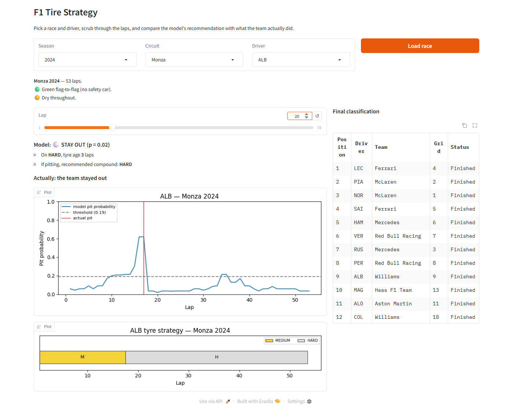
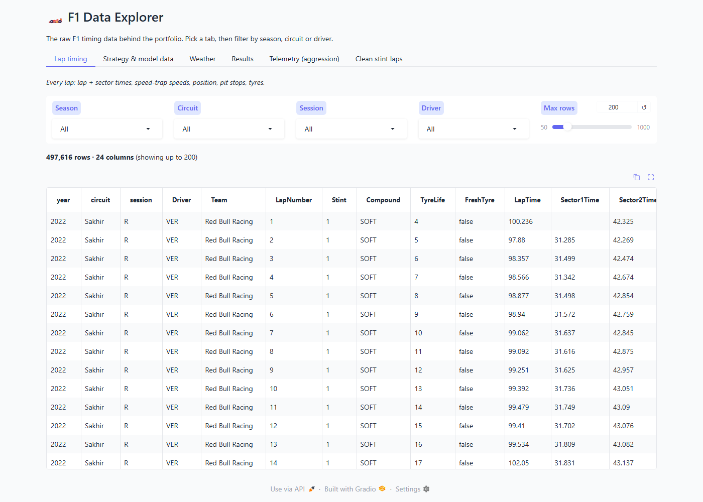

# F1 Machine Learning Portfolio

A portfolio of production-grade ML projects built entirely on real Formula 1 data
(via the [FastF1](https://docs.fastf1.dev/) timing API). Each project demonstrates a
distinct skill cluster — clean pipelines, honest evaluation, uncertainty,
sequential deep learning, unsupervised learning — and ships as a live, free demo.

Built as a single **uv workspace** (one lockfile, shared toolchain) with a shared
data foundation that every project depends on.

## Live demos

| | Link |
|---|---|
| 🔎 **F1 Data Explorer** — browse every field of every dataset (all sessions: FP/Q/Sprint/Race, weather, results, lap timing) | https://huggingface.co/spaces/reemkhattar/f1-data-explorer |
| 🏎️ **Tire Strategy** — scrub a historical race; see the model's pit/compound call vs what the team actually did | https://huggingface.co/spaces/reemkhattar/f1-tire-strategy |

The demos run on free Hugging Face hardware and sleep when idle, so the first load
can take ~30 s.



## Structure

```
f1-ml/                       uv workspace (one shared uv.lock)
├── 00-data-explorer/        shared FOUNDATION — package f1_foundation
│                            (FastF1 ingestion + the data explorer + shared cache/data)
├── 01-tire-strategy/        Project 1 — depends on the foundation
├── 02-lap-anomaly-detection/    (planned)
├── 03-race-outcome-prediction/  (planned)
├── 04-driving-style-clustering/ (planned)
├── data/                    gitignored: shared FastF1 cache + all processed parquets
└── .github/workflows/       CI: weekly model refresh + hourly explorer backfill
```

The dependency arrow always points `01–04 → 00`. Any project parquet written to the
shared `data/processed/` shows up in the explorer automatically.

## The projects

### 00 · Data Foundation & Explorer — ✅ complete, live
The shared data layer (`f1_foundation`): raw FastF1 ingestion, the shared cache/data
config, and a Gradio explorer that lets anyone browse the raw material behind the
models — every session type, filterable by season / circuit / session / driver.
Kept fresh by a rate-limit-aware, resumable GitHub Actions backfill.



### 01 · Tire Strategy Prediction — ✅ complete, live
Predicts pit-stop timing and tyre-compound choice from live race state on the
2022–2025 ground-effect era. A **decomposed two-head model** — a calibrated
pit-timing head and a slick compound head, with a deterministic rain gate for wet
stops — evaluated with grouped cross-validation and an **asymmetric
strategic-cost** metric (a missed pit costs more than a spurious one).

| Metric (5-fold grouped CV, 92 races) | Model | "Never pit" | Rule-based |
|---|---|---|---|
| Asymmetric strategic cost (lower better) | **0.312 ± 0.010** | 0.457 | 0.441 |
| Pit-head average precision | **0.354** | — | — |
| Compound accuracy / macro-F1 | **0.659 / 0.626** | 0.505 | — |

Includes MLflow tracking, a committed experiment log, a FastAPI service, and a
pit-loss-vs-degradation race simulator. Full write-up:
[`01-tire-strategy/docs/IMPLEMENTATION.md`](01-tire-strategy/docs/IMPLEMENTATION.md).

### 02–04 — planned
Lap-time anomaly detection (PyTorch LSTM autoencoder), race-outcome prediction with
conformal uncertainty, and driving-style clustering (HDBSCAN + UMAP). Each will be a
new workspace member building on `f1_foundation`.

## Tech stack

Python 3.11 · **uv** workspace · FastF1 · pandas / numpy · scikit-learn · LightGBM ·
PyTorch (projects 02/04) · MLflow · FastAPI + uvicorn · Gradio on Hugging Face Spaces ·
**just** · **ruff** (lint + format) · **pyright** · pytest · pre-commit · GitHub Actions.

## Running it

```bash
just install          # uv sync the whole workspace
just check            # ruff + pyright + pytest
just explorer         # run the data explorer locally
just demo             # run the tire-strategy demo locally
```

See [`01-tire-strategy/docs/DATA_UPDATES.md`](01-tire-strategy/docs/DATA_UPDATES.md)
for how the data stays fresh (manual, local schedule, or cloud CI).
